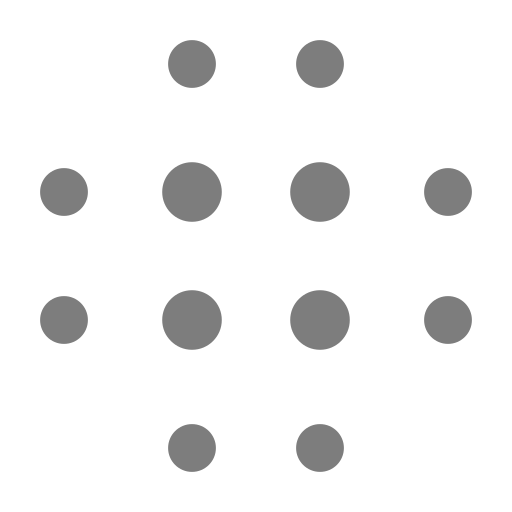
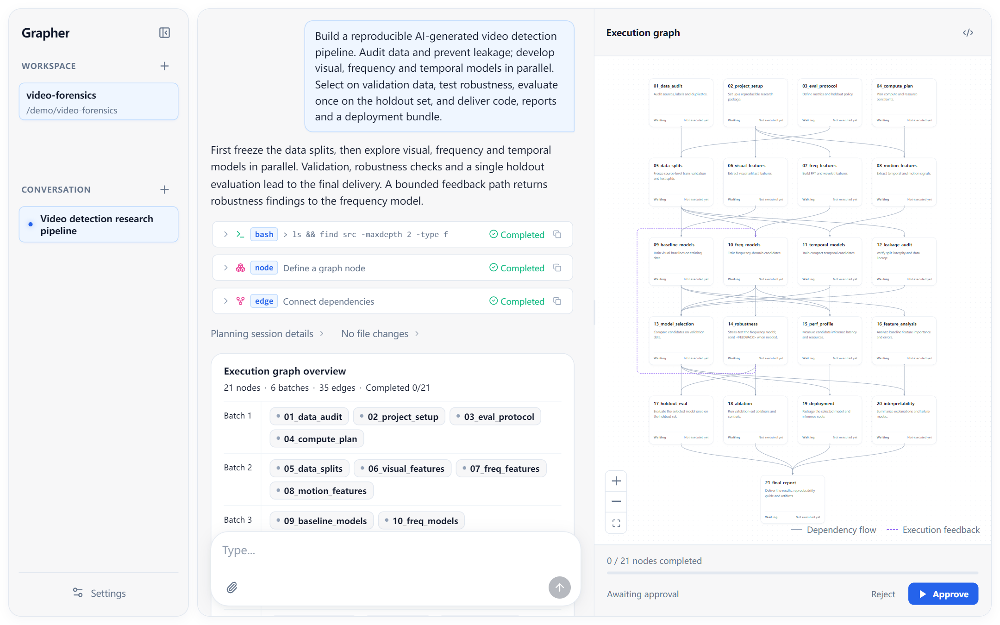
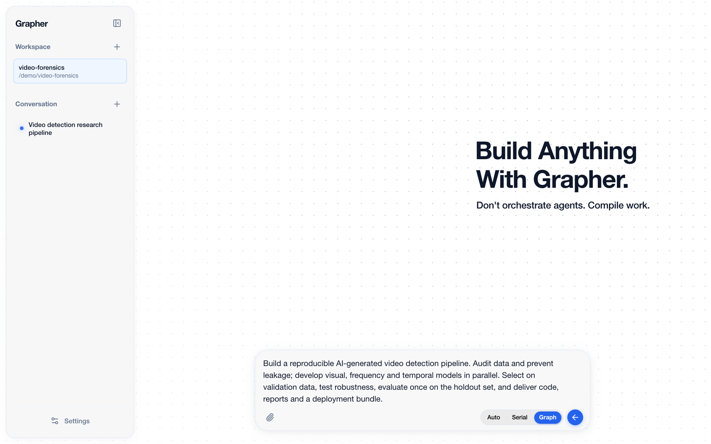

<p align="center">
  
</p>

<h1 align="center">Grapher</h1>

<p align="center">
  <strong>Don't orchestrate agents. Compile work.</strong><br>
  No more “lost in translation”.
</p>

<p align="center">
  A local coding-agent workbench that turns complex work into inspectable execution graphs.<br>
  Built on <a href="https://github.com/earendil-works/pi">Pi</a>
</p>

<p align="center">
  <a href="#quick-start">Quick start</a> ·
  <a href="#how-it-works">How it works</a> ·
  <a href="docs/user-guide.md">User guide</a> ·
  <a href="README.zh-CN.md">简体中文</a>
</p>

<p align="center">
  <a href="https://github.com/zhexusun10/grapher/actions/workflows/planner-source.yml"></a>
  <a href="LICENSE"></a>
  <a href="https://www.rust-lang.org/"></a>
</p>

<p align="center">
  
  <br><sub>Current UI with a 21-node example plan: parallel branches, execution batches and bounded feedback. Shown with manual approval enabled; not a completed run.</sub>
</p>

## Typical multi-agent systems vs Grapher

```text
Typical multi-agent systems

Goal → Supervisor LLM → Agent → Supervisor LLM → Agent → ...
             ↑ scheduling lives inside the conversation loop


Grapher

Goal → Planner → Compiled Graph → Deterministic Runtime
                                      ├── Agent A ──┐
                                      ├── Agent B ──┼──→ Agent D
                                      └── Agent C ──┘
```

**Core differences:**

1. **No supervisor in the execution loop** — The LLM plans the graph, then gets out of the scheduler.
2. **Never lost in translation (Zero conversational message passing)** — Traditional multi-agent systems rely on endless agent-to-agent chatter where requirements and constraints degrade like a game of telephone. In Grapher, nodes never exchange chat messages; parallel tasks inherit verifiable Git code states and history, not conversations.
3. **The graph is executable state** — Dependencies, retries, feedback, and publication are explicit runtime transitions.
4. **No predefined agent roles** — All nodes run general-purpose coding agents; specialization comes from task context, not hardcoded roles.

## Why Grapher?

- **Integrated coding-agent workbench** — Chat with coding agents, manage provider authentication and per-role model settings, inspect tool calls, logs, and file diffs, and intervene from the same UI.
- **Deterministic orchestration** — Scheduling, dependencies, invalidation, retries, and bounded feedback are explicit Rust state transitions. We don't introduce prior bias to the model; keep it flexible and general-purpose by decoupling model usage from system orchestration: deterministic and systemic rules belong to the runtime/harness, not to prompts that expose system details.
- **Workspace inheritance (Code, not chat)** — Children inherit parent Git history and its complete project-file state, including files matched by `.gitignore`. Nothing is lost in translation across inter-agent dialogue because agents never chat with each other: conversations stay strictly within their own nodes, while code flows through verified Git snapshots. Small execution batches share source for live file access; larger batches use private workspaces and deliver their results before the next batch starts.
- **Inspectable execution graph & loop engineering** — See dependencies, parallel branches, and bounded rework in the UI. Auto Approve and post-task Planner review default on for autonomous multi-turn iteration; turn off Auto Approve to review each graph before execution.
- **Local-first** — Run on your machine and publish valid Graph results back to your codebase before declaring completion. Model requests still go to your configured provider.

## When should I use Grapher?

<p align="center">
  
  <br><sub>Start with a goal, then choose Serial or Graph. Auto can be enabled in Harness settings.</sub>
</p>

**More agents are not always better.** Grapher works best when a coding task contains independent workstreams, for example:

- Frontend + backend changes
- Implementation + tests
- Machine-learning and research pipelines with independent feature, training, and evaluation modules
- Implementation followed by bounded review/rework

For small, linear, or tightly coupled tasks, use **Serial** instead. Use **Graph** when explicit dependencies and independent workstreams justify it; **Auto** lets the Partitioner choose.

| | Serial | Graph |
| --- | --- | --- |
| Best for | Small / linear tasks | Independent workstreams |
| Coding agents | One | One or more task nodes |
| Planning | Direct | Compiled execution graph |
| Approval | Automatic | Auto Approve by default; manual approval optional |
| Workspace | Your project | Selected per dispatch batch: shared source for up to two nodes, private workspaces above two |
| Scheduling | Sequential | Dependency-aware, bounded parallelism |

All five **Settings → Harness settings** options default on; saved opt-outs are preserved. Turn off **Hide Auto mode** to show Auto and Partitioner model settings.

By default, each dispatch batch of up to two nodes shares source; larger batches use isolation. After the batch drains and delivers its results, the next batch chooses again, including work added during Planner review. **Settings → Harness settings** can disable isolation for new conversations. Sharing reduces setup and merge costs, but overlapping edits may overwrite each other.

See the [user guide](docs/user-guide.md) for planning side effects, controls and recovery. Graph is a route, not a minimum agent count; it can contain a single node.

## Quick start

**Requirements:** Node.js 22.19+, stable Rust, Git, npm, network access, and provider authentication. Windows needs Git for Windows Bash; macOS needs Xcode Command Line Tools for the Rust linker and uses the built-in Seatbelt sandbox for private Graph execution; private Linux Graph execution needs bubblewrap and permitted unprivileged user/mount/PID namespaces.

**No build tools?** Download a ready-to-run [release archive](https://github.com/zhexusun10/grapher/releases/latest) instead: verify its `.sha256` checksum, extract it, and run `start.bat` (Windows) or `./start.sh` (macOS/Linux). Archives still require Node.js 22.19+ and Git at runtime; Rust and npm are not needed.

```sh
git clone --recurse-submodules https://github.com/zhexusun10/grapher.git
cd grapher
npm run dev
```

`npm run dev` automatically checks prerequisites, initializes submodules, installs locked dependencies, and builds the backend. For manual or step-by-step setup, you can also run `npm ci --ignore-scripts` followed by `npm run pi:setup`.

Open **<http://127.0.0.1:1420>**. The first launch may take time while Cargo compiles. On macOS, the backend keeps the display and system awake while it runs, so long tasks are not interrupted by idle sleep or the screen-saver lock; set `GRAPHER_KEEP_AWAKE=0` to disable this.

1. In **Settings**, select a local project, authenticate a provider, and choose a `provider/model`. You can also sign in through `npm run pi`.
2. Enter a coding goal. Choose **Serial** for a single Pi agent or **Graph** for a task graph. To let the Partitioner choose, show **Auto** in Harness settings.
3. Graph starts automatically by default. To inspect and **approve** each plan first, turn off **Auto Approve** before submitting. Follow node logs, pause running nodes and later continue their sessions, or send instructions.
4. Private Graph work is complete after valid results are published; shared-source work edits your project directly. Publication failures preserve state for inspection or retry.

**Use trusted projects; start with a disposable one.** Planner Bash writes directly to the source before approval, even if planning fails or is cancelled; snapshots force-collect project files into Git except Runtime/managed-environment internals. Reject is not rollback. Windows workspaces are not filesystem sandboxes. Read [Before you approve](docs/user-guide.md#before-you-approve) and the [filesystem boundaries](docs/architecture/filesystem-isolation.md) before important work.

For an existing clone, first run `git submodule update --init --recursive`. Pi is pinned; a global Pi installation is not substituted.

For local production mode:

```sh
npm run build
npm start
```

Open <http://127.0.0.1:1421>.

## How it works

```text
Coding goal
    |
    v
Partitioner
    |-- Simple / linear task --> Serial agent --> User's project
    |
    '-- Independent workstreams
                |
                v
             Planner
                |
                v
       Execution graph --> Compiler --> User approval
                                           |
                                           v
                              Deterministic Rust runtime
                                  |               |
                               Agent A         Agent B
                                  \               /
                                  Workspace inheritance
                                           |
                                           v
                                        Agent C
                                           |
                                           v
                                  Publish to project
```

Models decide how to split the work and perform each task. The compiler validates the graph. After compilation, the planner can stop: scheduling no longer depends on a coordinator's next message. Ordinary dependencies form a DAG: a child runs after its parents complete and inherits parent Git history plus the complete project-file state, including paths matched by `.gitignore`. Applied feedback sends bounded rework instructions and hands the sender's completed workspace to a fixed target, which continues its own conversation. Private project outputs use Git snapshots; shared-source nodes use live project files instead of snapshot handoffs. Conversations are never exchanged between nodes, ensuring technical intent and codebase reality are never lost in translation.

When enabled, **Post-task Planner review** invokes the Planner once all nodes finish and results are delivered, through publication or direct source edits. The Planner inspects the updated workspace and decides the next step—auditing results, formulating a follow-up plan, reporting to the user, or completing wrap-up work—without violating node isolation (Git workspace inheritance with zero node-to-node messaging). Paired with **Auto Approve**, this supports robust, multi-turn loop engineering.

## Architecture

**Models do the coding; the runtime owns the workflow.** Grapher keeps dependencies, bounded rework and delivery explicit instead of delegating scheduling to another conversation. You can inspect the plan, intervene during execution and verify that the result reached your project.

For everyday operation, read the [user guide](docs/user-guide.md). Building or changing Grapher? Start with [developer architecture](docs/architecture/overview.md) for component boundaries and canonical contracts.

## Development

```sh
npm run check
npm run build
npm run test:frontend
npm run test:backend          # Rust fixtures; no paid model
```

See [Contributing](CONTRIBUTING.md) and the [testing guide](docs/development/testing.md) for integration/platform checks and log acceptance. Report vulnerabilities through the [security policy](SECURITY.md). Model-free tests do not establish provider quality or every sandbox boundary.

## Documentation

**Using Grapher:** [User guide](docs/user-guide.md) · [Security policy](SECURITY.md).

**Developing Grapher:** [Architecture contracts](docs/architecture/overview.md) · [Contributing guide](CONTRIBUTING.md) · [Benchmarks](docs/benchmarks/harbor.md).

The [documentation index](docs/index.md) separates user guidance from developer task routes. Coding agents should use [AGENTS.md](AGENTS.md) for repository constraints.

## License

Original Grapher code is licensed under the [MIT License](LICENSE), copyright © 2026 Sun Zhe-xu. The upstream `pi/` submodule has its own [MIT license and copyright notice](pi/LICENSE). Third-party dependencies retain their respective licenses.
