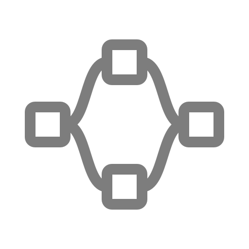
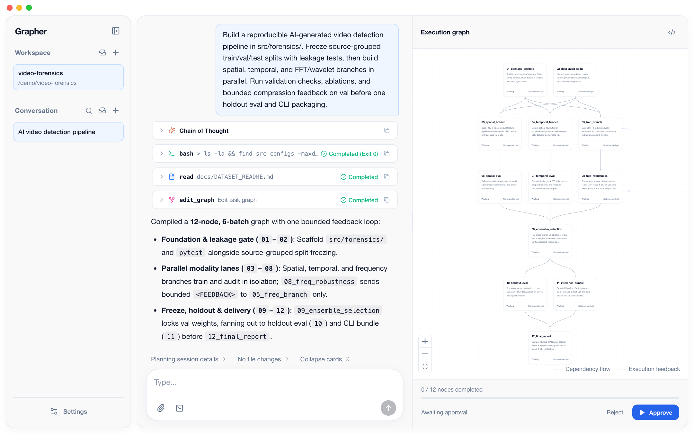
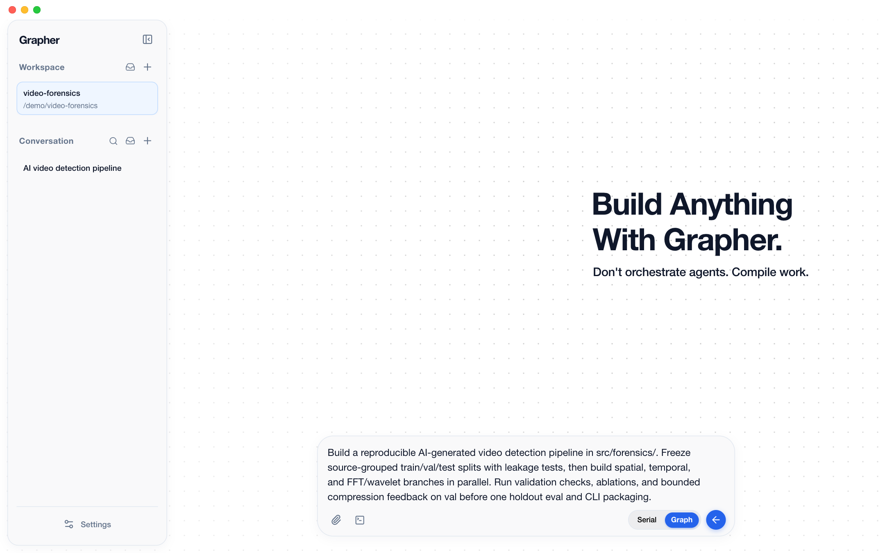

<p align="center">
  
</p>

<h1 align="center">Grapher</h1>

<p align="center">
  <strong>Don't orchestrate agents. Compile work.</strong><br>
  Stop losing code in multi-agent chat loops. Turn complex engineering goals into inspectable execution graphs—powered by a deterministic Rust runtime and Git state inheritance.
</p>

<p align="center">
  Local-first coding-agent workbench built on <a href="https://github.com/earendil-works/pi">Pi</a>
</p>

<p align="center">
  <a href="#quick-start">Quick start</a> ·
  <a href="#why-grapher">Why Grapher</a> ·
  <a href="#how-it-works">How it works</a> ·
  <a href="docs/user-guide.md">User guide</a> ·
  <a href="README.zh-CN.md">简体中文</a>
</p>

<p align="center">
  <a href="https://github.com/zhexusun10/grapher/actions/workflows/planner-source.yml"></a>
  <a href="LICENSE"></a>
  <a href="https://www.rust-lang.org/"></a>
</p>

<p align="center">
  
  <br><sub>Grapher Workbench: A 12-node, 6-batch example plan compiled into parallel spatial, temporal, and frequency lanes, validation selection, and a bounded feedback loop (shown with manual approval enabled; not a completed run).</sub>
</p>

---

## Stop Playing Multi-Agent Telephone

Most multi-agent frameworks trap your work inside a fragile conversation loop: a "Supervisor LLM" summarizes instructions, chats with sub-agents, interprets their replies, and decides what to do next. With every handoff, technical constraints degrade, tokens burn, and context gets **lost in translation**.

**Grapher compiles the workflow out of the conversation.**

```text
Typical multi-agent systems (Conversational orchestration)

Goal → Supervisor LLM → Agent → Supervisor LLM → Agent → ...
             ↑ scheduling & state live inside a lossy chat loop


Grapher (Compiled execution graph)

Goal → Planner → Compiled Graph → Deterministic Rust Runtime
                                      ├── Agent A ──┐
                                      ├── Agent B ──┼──→ Agent D ──→ Git Publish
                                      └── Agent C ──┘
```

1. **Zero "Lost in Translation" (Code over Chat)** — Agents in Grapher never chat with each other. Downstream tasks inherit verifiable **Git commit history and full workspace state** (including `.gitignore` files), not summarized transcripts. Every agent starts with a clean context window and exact code.
2. **No Supervisor in the Execution Loop** — The LLM plans the graph once, then steps out of the scheduler. Dependencies, concurrency, retries, invalidation, and delivery are deterministic Rust state transitions.
3. **Autonomous Loop Engineering** — With **Auto Approve** and **Post-task Planner Review** enabled by default, Grapher closes the iteration loop: once a graph delivers its code, the Planner automatically inspects the updated repo and compiles follow-up work or final verification until the goal is met.
4. **No Hardcoded Role Theater** — Forget artificial "PM / Architect / QA" personas. Every node runs a full-capability coding agent whose specialization comes purely from its task objective and inherited codebase state.

## Why Grapher

- **Visual, Steerable Workbench** — Chat with agents, manage provider auth and per-role models, inspect live tool calls, thinking traces, and file diffs, and pause or steer any running node from a single UI.
- **Smart Workspace Handoffs** — At idle boundaries, small dispatches (≤3 nodes after the worker cap) work directly in your source tree. With isolation enabled, larger waves use private workspaces and publish after the whole batch succeeds, replacing each changed file atomically. Shared-source work refills free worker slots without waiting for unrelated siblings; overlapping edits are not isolated.
- **Bounded Feedback & Rework** — Connect review or verification nodes back to implementation nodes with explicit retry limits—catching regressions automatically without runaway loops.
- **Unbiased Models, Deterministic Harness** — Systemic orchestration rules live in the Rust runtime rather than bloated system prompts, keeping models sharp, general-purpose, and free of framework prior bias.
- **Local-First Control** — Everything executes on your machine and publishes verified results back to your local repository. Want human-in-the-loop control? Turn off **Auto Approve** to inspect and gate every graph before a single node runs.

## Right-Sized for Every Task: Serial vs. Graph

<p align="center">
  
  <br><sub>Start with a goal and choose Serial or Graph. Auto routing can be enabled in Harness settings.</sub>
</p>

**More agents are not always better.** Grapher gives you a fast single-agent mode for linear work and a compiled task graph when parallelism pays off:

- **Frontend + Backend** changes developed concurrently
- **Implementation + Tests** written and verified in parallel workstreams
- **ML & Research Pipelines** with independent feature engineering, training, and evaluation modules
- **Implementation + Review** with bounded automated rework routes

| | Serial | Graph |
| --- | --- | --- |
| **Best for** | Small, linear, or tightly coupled tasks | Complex goals with independent workstreams |
| **Coding agents** | Single agent | One or more task nodes (DAG + optional bounded feedback) |
| **Planning** | Direct execution | Compiled execution graph + optional post-task review loop |
| **Approval** | Immediate | Auto Approve by default; manual approval gate optional |
| **Workspace** | Direct in your project | Adaptive at idle boundaries: shared source for ≤3 dispatched nodes, private workspaces for >3 when isolation is enabled |
| **Scheduling** | Sequential | Dependency-aware, bounded parallelism in Rust |

> **Tip:** Not sure which mode fits? Enable **Auto** in **Settings → UI settings** (turn off *Hide Auto mode*) to let the Partitioner route each goal automatically, or toggle **Enable Feedback** in **Settings → Harness settings** to unlock bounded rework edges. See the [User Guide](docs/user-guide.md) for workspace isolation and batch delivery details.

## How it works

```text
Coding goal
    |
    v
Partitioner
    |-- Simple / linear task --> Serial agent --> User's project
    |
    '-- Independent workstreams
                |
                v
             Planner
                |
                v
       Execution graph --> Compiler --> Approval (Auto or Manual)
                                                  |
                                                  v
                                     Deterministic Rust runtime
                                         |               |
                                      Agent A         Agent B
                                         \               /
                                     Git workspace inheritance
                                                  |
                                                  v
                                               Agent C
                                                  |
                                                  v
                                         Publish to project
                                                  |
                                                  v
                                    Post-task Planner review (Loop)
```

1. **Plan & Compile** — The Planner decomposes your goal into a task graph, and the Rust compiler validates topology, dependencies, and feedback bounds. Once compiled, scheduling no longer depends on a coordinator LLM's next message.
2. **Execute & Inherit via Git** — Ready nodes run in parallel. When a child node starts, it inherits its parents' Git commit history and complete project file state (including `.gitignore` paths). When a feedback edge triggers, the target node receives the sender's completed workspace and bounded rework instructions while continuing its own conversation. Zero chat messages are ever passed between nodes.
3. **Publish & Loop** — Validated outputs are published back to your project. With **Post-task Planner Review** enabled, the Planner automatically inspects the delivered codebase and decides the next move—auditing results, spawning a follow-up graph, or wrapping up—forming a self-correcting engineering loop.

## Quick start

The terminal button beside attachments opens a workspace shell in both the browser and desktop apps. It runs on the machine hosting Grapher, in the selected workspace; minimizing keeps the shell alive, and closing terminates it.

### Option 1: Desktop App (Recommended — macOS & Windows)

Download the latest native installer from [GitHub Releases](https://github.com/zhexusun10/grapher/releases/latest) and verify its checksum against `SHA256SUMS.txt`:

- **macOS (Apple Silicon):** `Grapher_<version>_aarch64.dmg` (drag `Grapher.app` to Applications)
- **macOS (Intel):** `Grapher_<version>_x64.dmg` (drag `Grapher.app` to Applications)
- **Windows (x64):** `Grapher_<version>_x64-setup.exe` (per-user NSIS installer)

The desktop app bundles the Rust backend, pinned Pi/engine runtime, and Node.js `22.19.0` runtime—no separate Node.js, npm, Rust, or manual Git installation is required (if no working Git is present on the machine, the app automatically downloads a verified portable copy on first launch).

- **Data & migration:** Desktop runtime data lives in your OS application data directory (`~/Library/Application Support/io.github.zhexusun10.grapher/data` on macOS; `%APPDATA%\io.github.zhexusun10.grapher\data` on Windows), while provider logins stay shared in `~/.grapher/pi-agent`. On first launch, if an existing `.grapher` store is found (or specified via `GRAPHER_LEGACY_DATA_DIR`), Grapher copies it atomically under exclusive lock while preserving the original legacy directory intact.
- **Updates:** Signed releases support cryptographically verified in-app updates under **Settings → Software Update** (macOS swaps `Grapher.app` in place and relaunches; Windows hands off to the signed NSIS installer, which updates and restarts Grapher automatically). Unsigned local or CI builds start normally and direct you to GitHub Releases for manual installer downloads. See the [capability matrix](docs/development/desktop-releases.md#updater--install-capability-matrix) for signing details.

### Option 2: Prebuilt CLI / Browser Archive (macOS, Linux & Windows)

Download the latest relocatable [release archive](https://github.com/zhexusun10/grapher/releases/latest) (`grapher-*.tar.gz` or `grapher-windows-x64.zip`), verify its checksum against `SHA256SUMS.txt`, extract it, and launch:

- **Windows:** `start.bat`
- **macOS / Linux:** `./start.sh`

*(Requires Node.js 22.19+ and Git on `PATH`.)*

### Option 3: Run or Build from Source

```sh
git clone --recurse-submodules https://github.com/zhexusun10/grapher.git
cd grapher
npm run dev
```

`npm run dev` checks prerequisites, initializes the pinned `pi/` submodule, installs locked dependencies, and compiles the Rust backend (for manual step-by-step setup, run `npm ci --ignore-scripts` then `npm run pi:setup`). For an existing clone, run `git submodule update --init --recursive` first.

- **Browser mode:** Open **<http://127.0.0.1:1420>** during `npm run dev`, or run `npm run build && npm start` and open <http://127.0.0.1:1421>.
- **Desktop dev mode (Tauri v2):** Run `npm run desktop:dev`.
- **Build native desktop installers:** Run `npm run desktop:build` (supports `--target macos-arm64`, `macos-x64`, or `windows-x64` on the matching OS). See [Desktop Releases & Secrets](docs/development/desktop-releases.md) for tag checklists, code-signing/notarization, and updater signing secrets.

### Your First Run

1. **Connect a project & model** — In **Settings**, bind a local project directory, authenticate your model provider (or sign in via `npm run pi`), and select a `provider/model`.
2. **Submit a goal** — Pick **Serial** for a single agent or **Graph** for a compiled task graph.
3. **Watch or steer** — Graph runs start automatically by default (turn off **Auto Approve** before submitting to review and approve plans manually). Inspect live node logs and diffs, pause/resume nodes, or send mid-flight instructions at any time.
4. **Verify delivery** — Shared-source runs edit your project live; isolated Graph batches publish verified results back to your codebase upon completion (preserving state for inspection or retry if publication fails).

**System requirements:**
- **Desktop installers:** Network access and model provider authentication. Node.js 22.19.0 and the pinned Pi runtime are bundled, and Git is downloaded automatically on first launch if absent on the host.
- **Archives & source builds:** Node.js 22.19+, Git, npm, plus stable Rust and native compiler/linker tools for source builds (macOS Xcode Command Line Tools; Windows MSVC Build Tools).
- **Platform notes:** macOS uses the built-in Seatbelt sandbox for private Graph workspaces and keeps the system awake while the backend runs, including when idle (`GRAPHER_KEEP_AWAKE=0` to disable); Linux private Graph workspaces require `bubblewrap` with unprivileged user/mount/PID namespaces enabled; Windows workspaces are not filesystem sandboxes.

## Documentation & Resources

| Guide | What it covers |
| --- | --- |
| **[User Guide](docs/user-guide.md)** | Everyday workflow, steering controls, workspace modes, data migration, recovery, and safety |
| **[Desktop Releases & Secrets](docs/development/desktop-releases.md)** | Tauri v2 desktop builds, installers, updater signing keys, macOS signing/notarization, and CI release workflow |
| **[Architecture Contracts](docs/architecture/overview.md)** | System boundaries, compiler rules, deterministic runtime, and Git workspace handoffs |
| **[Benchmarks](docs/benchmarks/harbor.md)** | Harbor evaluation harness and benchmark methodology |
| **[Contributing Guide](CONTRIBUTING.md)** & **[Testing](docs/development/testing.md)** | Development setup, ownership boundaries, and targeted test suites |
| **[Documentation Index](docs/index.md)** & **[Security Policy](SECURITY.md)** | Full documentation map, agent rules ([AGENTS.md](AGENTS.md)), and vulnerability reporting |

## License

Original Grapher code is licensed under the [MIT License](LICENSE), copyright © 2026 Sun Zhe-xu. The upstream `pi/` submodule is governed by its own [MIT license and copyright notice](pi/LICENSE). Third-party dependencies retain their respective licenses.
