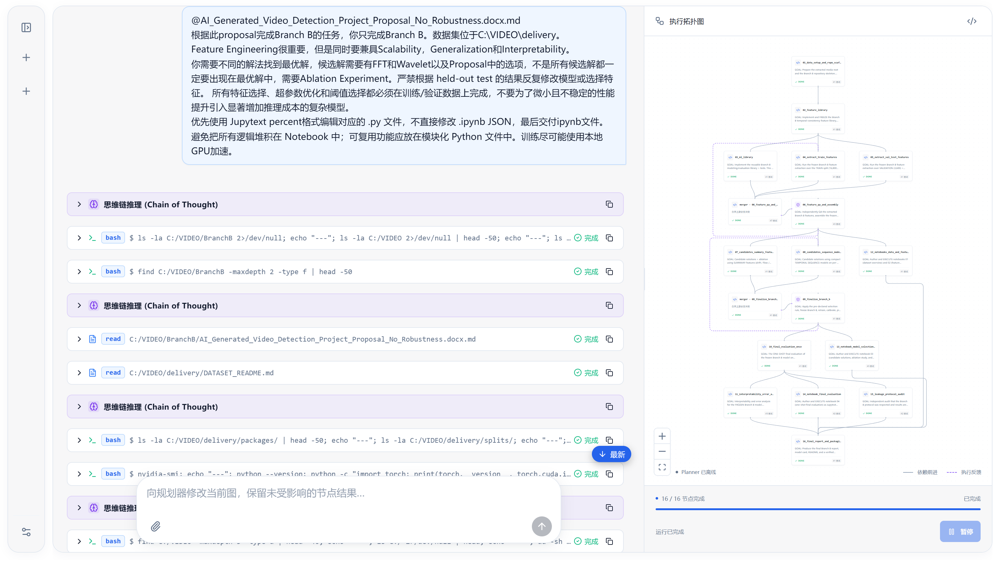

# Grapher

> **不编排智能体，编译工作。彻底告别“转述失真”。**
>
> **Don't orchestrate agents. Compile work.**  
> **No more "lost in translation".**

[](https://github.com/zhexusun10/grapher/actions/workflows/planner-source.yml)
[](LICENSE)
[](https://www.rust-lang.org/)

**将复杂工作编译为可检查执行图的本地 Coding Agent 架构。**

### 典型多智能体系统 vs Grapher

```text
典型多智能体系统

目标 → 主管 LLM → Agent → 主管 LLM → Agent → ...
          ↑ 调度存在于对话循环内部


Grapher

目标 → Planner → 编译后的执行图 → 确定性 Runtime
                                      ├── Agent A ──┐
                                      ├── Agent B ──┼──→ Agent D
                                      └── Agent C ──┘
```

**核心区别：**

1. **执行循环中没有主管** — LLM 规划执行图后退出调度器。
2. **彻底告别转述失真（Zero Conversational Message Passing，绝无 Lost in Translation）** — 传统多 Agent 系统依赖密集的 Agent 间对话，技术约束与设计细节在层层“传话筒”汇报中极易衰减和失真。Grapher 在节点间完全杜绝对话消息传递，任务间继承的是确定性的 Git 代码状态与文件历史，而不是容易产生幻觉的聊天记录。
3. **执行图就是可执行状态** — 依赖、重试、反馈和发布都是明确的运行时状态转换。
4. **没有预定义 Agent 角色** — 所有节点运行通用 Coding Agent；专业化来自任务上下文，而不是硬编码角色。

**并非所有工作都需要多个 Agent。** Grapher 在 **Auto** 模式下按意图路由，也允许手动选择：线性任务使用 **Serial**，并行有价值时使用 **Graph**。

基于 [Pi](https://github.com/earendil-works/pi) 构建。 [快速开始](#快速开始) · [工作方式](#工作方式) · [架构](docs/architecture/overview.md) · [English](README.md)



*真实 Grapher 界面，展示复杂任务编译生成的 16 节点执行拓扑图与规划全流程记录。*

## 为什么选择 Grapher？

- **集成式 Coding Agent 环境** — 在同一个界面中与 Coding Agent 对话、管理服务商认证与模型设置、查看工具调用和日志，并进行干预。
- **确定性编排** — 调度、依赖、结果失效和有界反馈是明确的 Rust 状态转换。我们不向模型注入 prior bias；模型使用层与系统编排层解耦，让模型保持灵活通用：确定性、系统性规则由 runtime/harness 负责，而不是靠 prompt 向模型暴露系统细节。
- **工作区继承（传递代码，而非闲聊）** — 子节点直接继承父节点的 Git 提交历史以及包含 `.gitignore` 在内的完整项目文件状态。节点之间绝不互相“对齐聊天”，彻底避免技术细节在多轮转述中失真（Lost in translation）；每个 Agent 的上下文保持干净专注，代码的交接与冲突由 Git 机制精确处理。线性任务可以交接 Git 工作区；fan-out 分支使用独立 Git worktree；Git 负责冲突和发布。
- **可检查的执行图** — 执行前查看并批准任务图；执行中可以看到依赖、并行分支和有界返工。
- **本地优先** — 在你的机器上运行，并在宣告完成前把有效的 Graph 结果发布回代码库。模型请求仍会发送给你配置的服务商。

## 什么时候应该使用 Grapher？

**Agent 并不是越多越好。** Grapher 最适合包含独立工作流的编程任务，例如：

- 前端 + 后端修改
- 实现 + 测试
- 机器学习任务天然具有多个独立模块
- 实现后进行有界审查 / 返工

小型、线性或高度耦合的任务应使用 **Serial**。只有当显式依赖和独立工作流值得拆图时才使用 **Graph**；**Auto** 让 Partitioner 选择路线。

| | Serial | Graph |
| --- | --- | --- |
| 适合任务 | 小型 / 线性任务 | 独立工作流 |
| 编程 Agent | 一个 | 一个或多个任务节点 |
| 规划 | 直接执行 | 编译执行图 |
| 审批 | 自动 | 默认由用户批准 |
| 工作区 | 用户项目 | 支持状态继承与独占交接的 Run 私有工作区 |
| 调度 | 顺序执行 | 依赖感知、有界并行 |

规划副作用和发布语义见[执行模型](docs/architecture/execution-model.md)。Graph 是执行路线，不是 Agent 数量下限；图也可以只有一个节点。

## 快速开始

**依赖：** Node.js 22.19+、稳定版 Rust、Git、npm、网络和服务商认证。Windows 需要 Git for Windows Bash；macOS 需要 Xcode Command Line Tools（用于 Rust 链接），Graph 使用系统内置 Seatbelt 沙箱；Linux Graph 需要 bubblewrap，并允许非特权 user/mount/PID namespace。

**不想安装编译工具？** 直接下载可运行的发布包：校验 `.sha256` 后解压，运行 `start.bat`（Windows）或 `./start.sh`（macOS/Linux）。发布包在运行时仍需要 Node.js 22.19+ 与 Git；无需 Rust 和 npm。

```sh
git clone --recurse-submodules https://github.com/zhexusun10/grapher.git
cd grapher
npm run dev
```

`npm run dev` 会自动检查环境工具、初始化子模块、安装锁定依赖并编译后端。也可手动执行 `npm ci --ignore-scripts` 与 `npm run pi:setup` 分步准备。

打开 **<http://127.0.0.1:1420>**。首次启动可能需要等待 Cargo 编译。

1. 在**设置**中选择本机项目，完成服务商认证并选择 `provider/model`。也可通过 `npm run pi` 登录。
2. 输入编程目标。选择 **Serial** 使用单个 Pi Agent，选择 **Graph** 规划任务图，或让 **Auto** 由 Partitioner 判断路线。
3. Graph 模式下查看并**批准**计划。执行中可查看节点日志、暂停正在运行的节点并稍后继续原会话，或追加指令。
4. Graph 的有效结果成功发布回项目后才算完成；发布失败会保留状态供检查或重试。

**只在可信项目上使用，首次体验建议用可丢弃的项目。** Planner 的 Bash 写入会在审批前直接修改源项目，规划失败或取消也不会回滚；Git 快照会强制收集项目文件，Runtime/环境内部目录除外。拒绝计划不等于回滚。Windows 工作区不是文件系统沙箱。在重要代码上运行前，请阅读[执行模型](docs/architecture/execution-model.md)和[文件系统边界](docs/architecture/filesystem-isolation.md)。

已有克隆仓库请先运行 `git submodule update --init --recursive`。Pi 是锁定版本，不会使用全局 Pi 替代。

本机生产模式：

```sh
npm run build
npm start
```

打开 <http://127.0.0.1:1421>。

## 项目状态

**Grapher 目前是 alpha 阶段软件。**

**已实现功能：**
- Serial 单 Agent 编程工作流
- Graph 任务图规划与审批
- 依赖感知的执行调度
- 工作区状态继承
- 有界反馈边
- 结果发布机制
- 任务后 Planner 复盘与闭环自主迭代（Loop Engineering）
- Linux 沙箱（bubblewrap）
- Windows/macOS/Linux 发布包与一键开发启动

**仍在完善：**
- 跨平台隔离（Windows 沙箱）
- 路由质量与图编译启发式
- 服务商兼容性覆盖
- 性能优化

## 工作方式

```text
编程目标
    |
    v
Partitioner
    |-- 简单 / 线性任务 --> Serial Agent --> 用户项目
    |
    '-- 独立工作流
                |
                v
             Planner
                |
                v
       执行图 --> 编译器 --> 用户批准
                                |
                                v
                    确定性 Rust 运行时
                      |               |
                   Agent A         Agent B
                      \               /
                      工作区继承
                                |
                                v
                             Agent C
                                |
                                v
                          发布到项目
```

模型负责拆分工作并执行具体任务，编译器负责验证图。编译完成后，Planner 可以退出：调度不再依赖协调器的下一条消息。普通依赖构成 DAG：子节点在父节点完成后运行，并继承父节点的 Git 历史以及完整项目文件状态，包括匹配 `.gitignore` 的路径。已应用的反馈会向固定目标发送有界返工指令，并把发送方已完成的工作区交给目标；目标继续自己的对话。所有项目输出都是 Git 提交；节点之间绝不交换对话上下文，确保技术意图与代码真实状态永远不会在多 Agent 传话中失真（Never lost in translation）。

开启**任务后 Planner 复盘**（Post-task Planner review）后，当图任务全部执行完毕并将代码发布写回源项目后，系统会自动唤起 Planner 审查最新状态并自主决定下一步行动——包括审核工作区、制定新计划/派发新节点、向用户汇报结果或完成收尾工作等，不做人工限制。整个流程始终严格遵循节点间无 message 传递的核心设计（通过 Git 工作区状态继承而非会话传递）。配合**自动批准（Auto Approve）**，可形成鲁棒的 Loop Engineering 自主迭代闭环。

## 架构

Rust 后端与 SQLite 事件日志拥有运行时状态，React 界面只显示投影。Graph 执行使用 Run 私有仓库，每个目录同时只有一个写入者；已完成的目录可以在节点之间交接，而不是永久绑定到某个节点。后端为项目文件准备完整 Git 快照，包括被 Git 忽略的路径；Agent 不交换提交。交付要求 Git 成功发布，而不仅仅是模型调用结束。

阅读[架构](docs/architecture/overview.md)了解动机与不变量，或阅读[执行模型](docs/architecture/execution-model.md)了解规划、会话、工作区继承、Git 快照与发布语义。底层运行时、隔离和 Pi 契约从这些页面继续导航，不在首页重复。

## 开发

```sh
npm run check
npm run build
npm run test:frontend
npm test                      # Rust 固定样例；无需付费模型
```

集成、平台验证和日志验收见[贡献指南](CONTRIBUTING.md)与[测试指南](docs/development/testing.md)。安全漏洞请按[安全政策](SECURITY.md)报告。无模型测试不能证明服务商效果或全部沙箱边界。

## 文档导航

先查看面向任务的[文档索引](docs/index.md)。Coding Agent 应使用 [AGENTS.md](AGENTS.md) 进行导航并了解仓库约束。

- [架构](docs/architecture/overview.md)
- [执行模型](docs/architecture/execution-model.md)
- [开发指南](docs/development/contributing.md)
- [Benchmark / Evaluation](docs/benchmarks/harbor.md)

## 许可证

Grapher 原创代码采用 [MIT 许可证](LICENSE)，版权所有 © 2026 Sun Zhe-xu。上游 `pi/` 子模块遵循其自身的 [MIT 许可证和版权声明](pi/LICENSE)；第三方依赖仍遵循各自的许可证。
