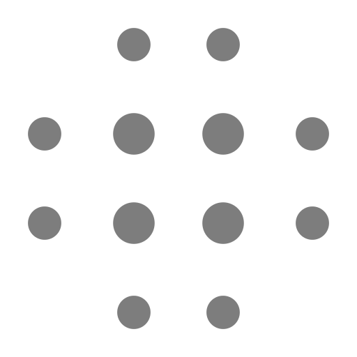
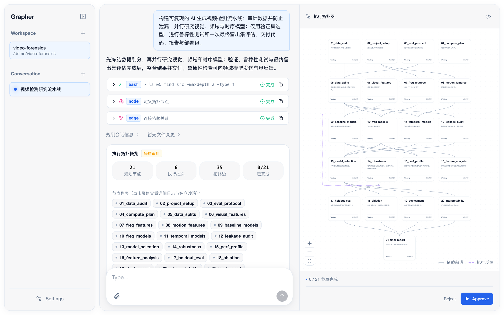
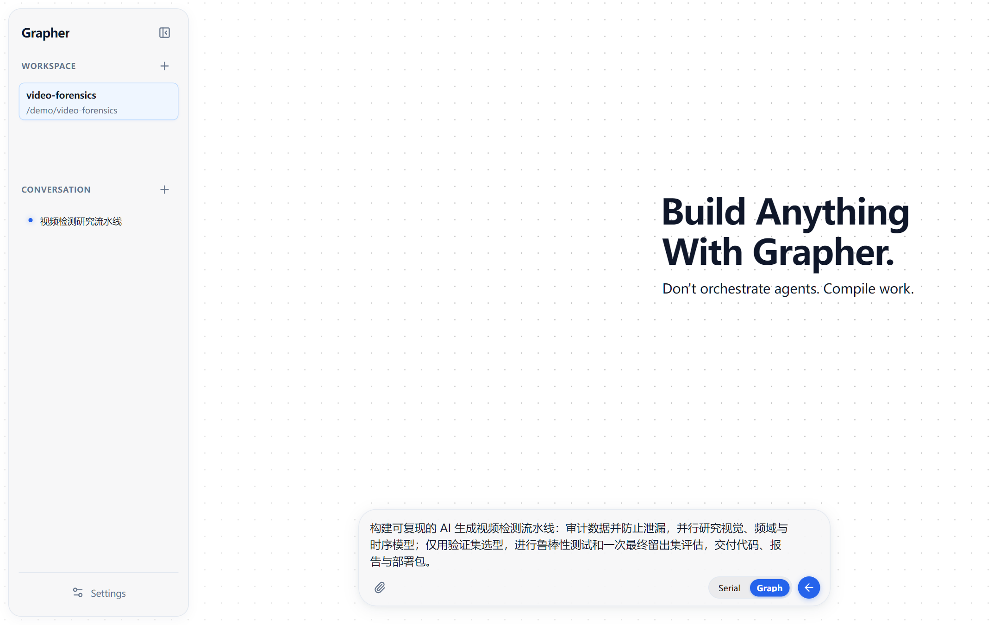

<p align="center">
  
</p>

<h1 align="center">Grapher</h1>

<p align="center">
  <strong>不编排智能体，编译工作。</strong><br>
  告别多 Agent“传话筒”式的转述失真。将复杂工程目标编译为可检查的执行图——由确定性 Rust 运行时驱动，以 Git 状态无缝交接。
</p>

<p align="center">
  基于 <a href="https://github.com/earendil-works/pi">Pi</a> 构建的本地优先 Coding Agent 工作台
</p>

<p align="center">
  <a href="#快速开始">快速开始</a> ·
  <a href="#为什么选择-grapher">为什么选择 Grapher</a> ·
  <a href="#工作方式">工作方式</a> ·
  <a href="docs/user-guide.md">使用指南</a> ·
  <a href="README.md">English</a>
</p>

<p align="center">
  <a href="https://github.com/zhexusun10/grapher/actions/workflows/planner-source.yml"></a>
  <a href="LICENSE"></a>
  <a href="https://www.rust-lang.org/"></a>
</p>

<p align="center">
  
  <br><sub>Grapher 工作台：包含 21 个节点的示例计划，直观呈现并行分支、执行批次与有界反馈（图中已开启手动审批，并非已完成的运行记录）。</sub>
</p>

---

## 告别多 Agent“传话筒”式内耗

绝大多数多智能体框架都把工作困在脆弱的对话循环里：由一个“主管 LLM”居中传话——总结需求、派发给子 Agent、解读回复、再决定下一步。每经过一轮对话转述，技术细节与架构约束就会像“传话游戏”一样层层衰减，不仅白白消耗大量 Token，更让关键需求在闲聊中**转述失真（Lost in Translation）**。

**Grapher 将工作流从对话中彻底“编译”出来。**

```text
典型多智能体系统（基于对话的编排）

目标 → 主管 LLM → Agent → 主管 LLM → Agent → ...
          ↑ 调度与状态完全困在易失真的聊天循环内


Grapher（编译式执行图）

目标 → Planner → 编译后的执行图 → 确定性 Rust Runtime
                                      ├── Agent A ──┐
                                      ├── Agent B ──┼──→ Agent D ──→ Git 发布写回
                                      └── Agent C ──┘
```

1. **零转述失真（传递代码，而非闲聊）** — Grapher 节点之间**绝不交换任何聊天消息**。下游任务直接继承父节点真实的 **Git 提交历史与完整项目文件状态**（含 `.gitignore` 文件）。每个 Agent 都拥有干净专注的上下文窗口与确定性的代码基线。
2. **执行循环中没有“主管”** — LLM 完成任务图规划后即退出调度器。依赖解析、并发派发、重试、失效重算与结果交付，全部由确定性的 Rust 状态机严格驱动。
3. **自主闭环迭代（Loop Engineering）** — 默认开启 **自动批准（Auto Approve）** 与 **任务后 Planner 复盘**。当一张执行图交付代码后，Planner 会自动审查最新代码库并自主决定下一步——发起后续迭代图、补齐验证或汇报收尾，形成真正的端到端自演进闭环。
4. **拒绝预定义“角色扮演”** — 没有僵硬的“产品经理 / 架构师 / 测试员”人设。所有节点均运行全能力的通用 Coding Agent，专业化完全源自具体的任务上下文与继承的代码状态。

## 为什么选择 Grapher

- **可视化、可随时干预的工作台** — 在同一界面与 Agent 对话、管理服务商认证与分角色模型配置、实时查看工具调用、思考过程与文件 Diff，并可随时暂停、恢复或向正在运行的节点追加指令。
- **自适应工作区交接** — 空闲时按并发上限过滤后的派发数量选择：≤3 个节点共享源目录；开启隔离时，>3 个节点使用独立工作区，整批成功后写回项目，每个变更文件以原子替换方式安装。共享执行期间会及时补充空闲槽位，不等待无关节点；并发修改同一文件不受隔离保护。
- **有界反馈与自动返工** — 支持将审查或测试节点通过有界反馈边连回实现节点，在明确的次数上限内自动触发返工修复，既能兜底质量又绝不陷入死循环。
- **模型零偏置，编排归 Runtime** — 确定性的系统规则由 Rust Runtime 兜底，不靠冗长的系统 Prompt 向模型灌输框架细节，避免引入先验偏置（Prior Bias），充分释放底座模型原生编码实力。
- **本地优先，掌控全局** — 在本机直接运行，验证通过的结果安全写回本地代码库。需要人工把关？只需关闭 **Auto Approve**，即可在每次执行前逐图审阅、批准。

## 按需选型：Serial vs. Graph

<p align="center">
  
  <br><sub>从一个目标出发，按需选择 Serial 或 Graph；也可在 Harness 设置中开启 Auto 自动路由。</sub>
</p>

**Agent 并不是越多越好。** 面对简单任务，Grapher 提供轻量直接的单 Agent 模式；面对复杂工程，才用编译式执行图释放并行生产力：

- **前端 + 后端** 跨模块特性并行开发
- **功能实现 + 测试套件** 独立推进与交叉验证
- **机器学习与研究流水线**（特征工程、训练、评估等多模块并行）
- **实现 + 代码审查 / 有界返工** 的高可靠交付

| | Serial（串行） | Graph（执行图） |
| --- | --- | --- |
| **最佳场景** | 小型、线性或高度耦合的修改 | 包含多条独立工作流的复杂工程 |
| **Coding Agent** | 单个 Agent | 一个或多个任务节点（DAG + 可选有界反馈） |
| **规划方式** | 直接执行 | 编译执行图 + 可选任务后 Planner 复盘闭环 |
| **审批机制** | 立即执行 | 默认自动批准；可切换为手动逐图审批 |
| **工作区策略** | 直接操作用户项目 | 空闲时自适应选择：派发 ≤3 节点共用源目录；开启隔离时，>3 节点使用独立工作区 |
| **调度引擎** | 顺序执行 | 基于 Rust 的依赖感知与有界并发调度 |

> **提示：** 不确定选哪种模式？在 **Settings → Harness设置** 中关闭 *隐藏 Auto 模式* 即可让 Partitioner 根据目标自动选择路线；开启 **启用 Feedback** 即可解锁有界返工边。工作区隔离与批次写回机制详见[使用指南](docs/user-guide.md)。

## 工作方式

```text
编程目标
    |
    v
Partitioner
    |-- 简单 / 线性任务 --> Serial Agent --> 用户项目
    |
    '-- 独立工作流
                |
                v
             Planner
                |
                v
       执行图 --> 编译器 --> 批准（自动或手动）
                                  |
                                  v
                      确定性 Rust 运行时
                        |               |
                     Agent A         Agent B
                        \               /
                        Git 工作区状态继承
                                  |
                                  v
                               Agent C
                                  |
                                  v
                            发布到项目
                                  |
                                  v
                      任务后 Planner 复盘（Loop）
```

1. **规划与编译** — Planner 将目标拆解为任务图，Rust 编译器严格校验拓扑依赖与反馈上限。编译完成后，Planner 即可退出，后续调度不再依赖任何“协调器”的对话输出。
2. **并行执行与 Git 状态继承** — 就绪节点并行启动。子节点在父节点完成后直接继承其 Git 提交历史与完整项目文件状态（含 `.gitignore` 匹配路径）；触发反馈边时，目标节点接收发送方已完成的工作区与有界返工指令，并在其自身会话中继续演进。节点间全程零聊天传递。
3. **写回交付与闭环复盘** — 验证有效的结果写回用户项目。开启 **任务后 Planner 复盘** 后，系统会在图执行交付完毕后自动唤起 Planner 审查最新代码库，自主决定发起新一轮任务图、执行收尾检查或汇报完成，构建高鲁棒性的 Loop Engineering 闭环。

## 快速开始

### 方式一：下载免编译发布包（最快 — 无需安装 Rust 和 npm）

直接下载最新[发布包（Release Archive）](https://github.com/zhexusun10/grapher/releases/latest)，校验 `.sha256` 后解压运行：

- **Windows：** 双击或运行 `start.bat`
- **macOS / Linux：** 运行 `./start.sh`

*（运行时仅需 Node.js 22.19+ 与 Git。）*

### 方式二：从源码运行

```sh
git clone --recurse-submodules https://github.com/zhexusun10/grapher.git
cd grapher
npm run dev
```

`npm run dev` 会自动检查环境工具、初始化锁定的 `pi/` 子模块、安装依赖并编译 Rust 后端（如需分步执行，可运行 `npm ci --ignore-scripts` 与 `npm run pi:setup`）。已有克隆仓库请先运行 `git submodule update --init --recursive`。

打开 **<http://127.0.0.1:1420>**（首次启动需等待 Cargo 完成编译）。如需本机生产模式，可执行 `npm run build && npm start` 并访问 <http://127.0.0.1:1421>。

### 四步跑通你的第一个任务

1. **绑定项目与模型** — 在 **设置（Settings）** 中选择本机项目目录，完成服务商认证（或通过 `npm run pi` 登录）并选择 `provider/model`。
2. **输入编程目标** — 简单修改选 **Serial**，多工作流任务选 **Graph**。
3. **观察与实时干预** — Graph 默认自动批准并启动执行（如需先审阅计划，请在提交前关闭 **Auto Approve**）。执行中可随时查看节点日志与文件变更、暂停/继续节点，或直接向节点发送引导指令。
4. **确认结果写回** — 共享源目录模式直接修改源项目；独立工作区批次在全部成功后自动将有效结果发布回代码库（若发布冲突或失败，会完整保留状态供检查与重试）。

**环境依赖：** Node.js 22.19+、稳定版 Rust（仅源码构建需要）、Git、npm、网络与模型服务商认证。Windows 需安装 Git for Windows Bash；macOS 需安装 Xcode Command Line Tools（用于 Rust 链接），其 Graph 独立工作区使用系统内置 Seatbelt 沙箱，且运行期间默认保持系统唤醒（可通过 `GRAPHER_KEEP_AWAKE=0` 关闭）；Linux Graph 独立工作区需安装 `bubblewrap` 并开启非特权 user/mount/PID namespace。

> [!IMPORTANT]
> **安全与项目边界 — 请在可信项目上使用，首次体验建议先用可丢弃的测试项目。**
> Planner 的 Bash 命令会在计划审批前直接在源项目中执行，拒绝或取消计划**不会**回滚这些写入；Git 快照会强制收集除 Runtime/托管环境内部目录以外的项目文件（包括匹配 `.gitignore` 的路径）。Windows 工作区不是文件系统沙箱。在重要代码库上运行前，请阅读[审批前须知](docs/user-guide.md#before-you-approve)与[文件系统边界](docs/architecture/filesystem-isolation.md)。

## 文档与资源

| 文档 | 内容概览 |
| --- | --- |
| **[使用指南（User Guide）](docs/user-guide.md)** | 日常操作流程、节点干预、工作区模式、异常恢复与安全须知 |
| **[架构契约（Architecture Contracts）](docs/architecture/overview.md)** | 系统组件边界、编译器规则、确定性 Runtime 与 Git 工作区交接机制 |
| **[基准评测（Benchmarks）](docs/benchmarks/harbor.md)** | Harbor 评测框架接入与基准测试方法 |
| **[贡献指南](CONTRIBUTING.md)** 与 **[测试指南](docs/development/testing.md)** | 开发环境搭建、模块归属边界与按需验证测试套件 |
| **[文档索引](docs/index.md)** 与 **[安全政策](SECURITY.md)** | 完整文档路由、Coding Agent 仓库约束（[AGENTS.md](AGENTS.md)）与漏洞报告方式 |

## 许可证

Grapher 原创代码采用 [MIT 许可证](LICENSE)，版权所有 © 2026 Sun Zhe-xu。上游 `pi/` 子模块遵循其自身的 [MIT 许可证和版权声明](pi/LICENSE)；第三方依赖仍遵循各自的许可证。
